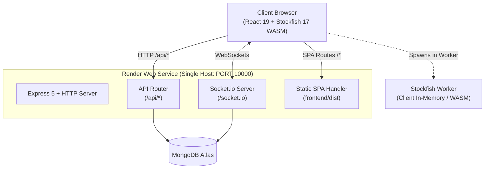

# ♟ ChessPulse — Unified Full-Stack Platform

<div align="center">


<br/>

[](https://react.dev/)
[](https://vitejs.dev/)
[](https://expressjs.com/)
[](https://nodejs.org/)
[](https://socket.io/)
[](https://www.mongodb.com/atlas)
[](https://stockfishchess.org/)
[](https://render.com/)

<p align="center">
  <strong>A high-performance chess intelligence platform combining a React 19 SPA, Express 5 API, Socket.io real-time engine, and in-browser Stockfish 17 WASM worker into a single unified deployment for Render.</strong>
</p>

[Key Features](#-key-features) •
[Architecture](#-architecture) •
[Quick Start](#-local-development) •
[Deploy to Render](#-deploying-to-render) •
[Environment Variables](#-environment-variables) •
[Project Structure](#-project-structure)

</div>

---

## 🌟 Key Features

- **⚡ Client-Side Stockfish 17 NNUE WASM**: Multi-threaded neural chess engine operating directly in a Web Worker inside the browser. Achieves 0ms server latency and requires zero cloud compute for evaluations.
- **🤖 3D Carousel Bots Arena**: Interactive 3D coverflow carousel showcasing personality-driven chess bots spanning 800 to 2800 ELO with custom opening repertoires and adaptive blunder rates.
- **⏱️ Live Matchmaking & Matrix Time Controls**: Real-time multiplayer rooms powered by Socket.io with Bullet (1+0, 2+1), Blitz (3+0, 5+3), and Rapid (10+0, 15+10) cadences.
- **🧩 Advanced Puzzles Suite**: Bento-style puzzle training with Rated Puzzle Rush, Survival mode, motif-based themed puzzles, curated grandmaster collections, and global ELO leaderboards.
- **🔬 Studio Game Analysis & Recruiter Sandbox**: Interactive analysis board with centipawn evaluation graph, accuracy calculation, blunder vectorization, custom PGN ingestion terminal, and live pipeline simulation stepper.
- **🎨 Complete Board Customization**: Dynamic piece sets, sound effects, board themes, and 100% responsive High-Contrast Light and Dark mode styling.
- **🛡️ Production Authentication**: Dual JWT authentication (access + refresh token rotation) with MongoDB Atlas persistence and Google OAuth 2.0 integration.

---

## 🏛 Architecture

In this unified monorepo, Express 5 acts as both the backend API server, the real-time WebSocket hub, and the static file server for the production React build:



### Why a Single Unified Service?
1. **Zero CORS Friction**: Frontend and backend share the exact same origin (`https://<app>.onrender.com`). No cross-domain cookie restrictions or browser security blocks.
2. **Instant WebSockets**: Socket.io connects directly to `window.location.origin` without needing separate hostnames or SSL certificates.
3. **Optimized WASM Security**: Helmet headers are pre-tuned so `stockfish.wasm` and Web Workers run without Content-Security-Policy (CSP) interference.
4. **No Free-Tier Sleep Mismatch**: The frontend and backend never go out of sync because they run on the same instance.

---

## 📁 Project Structure

```
chesspulse-unified/
├── backend/                       # Express 5 + Socket.io Server
│   ├── config/                    # MongoDB Atlas connection & Passport OAuth strategy
│   ├── middleware/                # JWT auth, rate limiter, validators, error handler
│   ├── models/                    # Mongoose schemas (User, BotGame, OnlineGame, etc.)
│   ├── routes/                    # REST endpoints (/api/auth, /api/puzzles, /api/bot-games)
│   ├── socket/                    # Live multiplayer Socket.io game rooms & clocks
│   ├── utils/                     # ELO calculator, JWT utils, Gemini AI
│   ├── .env.example               # Backend environment reference
│   ├── package.json               # Backend dependencies
│   └── server.js                  # Main server (routes /api, WebSockets & serves frontend/dist)
│
├── frontend/                      # React 19 + Vite Frontend
│   ├── public/                    # Stockfish 17 WASM & Worker, samples, audio assets
│   ├── src/                       # Components, pages, hooks, contexts, theme system
│   ├── index.html                 # HTML shell
│   ├── vite.config.ts             # Vite configuration with local /api & /socket.io proxy
│   ├── .env.example               # Frontend environment reference
│   └── package.json               # Frontend dependencies
│
├── .agents/skills/                # Antigravity Skills (render-deployment, custom-workflow)
├── .gitignore                     # Monorepo gitignore (ignores node_modules, dist, .env)
├── .env.example                   # Master environment documentation
├── package.json                   # Root orchestrator (scripts: build, start, dev, install:all)
├── render.yaml                    # 1-Click Render Blueprint specification
└── README.md                      # Documentation & deployment guide
```

---

## 💻 Local Development

### 1. Prerequisites
- **Node.js**: v18.0.0 or higher
- **MongoDB**: A free MongoDB Atlas cluster URI (or local MongoDB instance)

### 2. Installation
Clone the repository and install all dependencies:
```bash
# Clone the repository
git clone https://github.com/<your-username>/chesspulse-unified.git
cd chesspulse-unified

# Install root, backend, and frontend dependencies in one command
npm run install:all
```

### 3. Configure Local Environment
Create a `.env` file inside `backend/` using `backend/.env.example`:
```ini
PORT=5001
NODE_ENV=development
MONGODB_URI=your_mongodb_atlas_connection_string
JWT_SECRET=your_local_jwt_secret_key
REFRESH_TOKEN_SECRET=your_local_refresh_token_secret
SESSION_SECRET=your_local_session_secret
```

### 4. Start Development Servers
Run both backend and frontend concurrently:
```bash
npm run dev
```
- **Backend API & WebSockets**: `http://localhost:5001`
- **Frontend App (Vite)**: `http://localhost:5173` *(Vite proxies `/api` and `/socket.io` to `5001`)*

---

## 🚀 Deploying to Render

### Manual Web Service Setup (Recommended)

1. Push your code to GitHub:
   ```bash
   git remote add origin https://github.com/<your-username>/chesspulse-unified.git
   git branch -M main
   git push -u origin main
   ```

2. Go to the [Render Dashboard](https://dashboard.render.com) and click **New +** → **Web Service**.
3. Select your `chesspulse-unified` repository.
4. Fill in the exact deployment settings below:

#### Service Settings

| Field | Value to Enter | Explanation |
|---|---|---|
| **Name** | `chesspulse` | The name of your service (becomes `chesspulse.onrender.com`) |
| **Region** | `Oregon (US West)` | Select the region closest to your MongoDB cluster |
| **Branch** | `main` | Production branch |
| **Root Directory** | *(Leave completely blank)* | Uses root `package.json` |
| **Runtime** | `Node` | Node.js runtime |
| **Build Command** | `npm run build` | Installs modules and builds `frontend/dist` |
| **Start Command** | `npm start` | Starts `node backend/server.js` |
| **Plan** | `Free` | Free tier available |

#### Advanced Settings
- **Health Check Path**: `/api/health`
- **Auto-Deploy**: `Yes`

---

## 🔐 Environment Variables

Add these environment variables under the **Environment** tab in your Render Web Service dashboard:

| Variable Key | Recommended / Example Value | Description |
|---|---|---|
| `NODE_ENV` | `production` | **Required.** Activates production static file serving |
| `PORT` | `10000` | **Required.** Port assigned by Render |
| `MONGODB_URI` | `mongodb+srv://<user>:<password>@cluster0.mongodb.net/?appName=Cluster0` | **Required.** MongoDB Atlas connection URI |
| `JWT_SECRET` | *(64-char random string)* | **Required.** Signs access tokens |
| `JWT_EXPIRES_IN` | `3h` | Access token lifespan |
| `REFRESH_TOKEN_SECRET` | *(64-char random string)* | **Required.** Signs refresh tokens |
| `REFRESH_TOKEN_EXPIRES_IN` | `7d` | Refresh token lifespan |
| `SESSION_SECRET` | *(Secure random string)* | **Required.** Encrypts session cookies |
| `GROQ_API_KEY` | `gsk_...` | *Optional.* AI coach commentary |
| `GOOGLE_CLIENT_ID` | `...apps.googleusercontent.com` | *Optional.* Google OAuth Login |
| `GOOGLE_CLIENT_SECRET` | `GOCSPX-...` | *Optional.* Google OAuth Secret |
| `GOOGLE_CALLBACK_URL` | `https://<your-render-name>.onrender.com/api/oauth/google/callback` | *Optional.* Google OAuth callback URL |

> [!TIP]
> Notice that `FRONTEND_URL` and `VITE_API_URL` are **not** needed in production because the frontend is served on the exact same host and automatically connects via relative `/api` and `window.location.origin`!

---

## 🛠 Available NPM Scripts

From the root of `chesspulse-unified`:

| Command | Action |
|---|---|
| `npm run dev` | Runs backend nodemon server and Vite frontend concurrently with colored logs |
| `npm run build` | Installs backend + frontend dependencies and compiles Vite into `frontend/dist` |
| `npm start` | Starts the production Express server (`node backend/server.js`) |
| `npm run dev:backend` | Starts only the backend with auto-reload (`nodemon backend/server.js`) |
| `npm run dev:frontend` | Starts only the Vite frontend dev server on port 5173 |
| `npm run install:all` | Installs dependencies at root, backend, and frontend |

---

## 🔍 Verification & Health Check

After deployment, verify that your service is healthy:

```bash
# 1. Test API Health Endpoint
curl https://<your-service>.onrender.com/api/health
# Response: {"success":true,"message":"ChessPulse Unified Server is healthy",...}

# 2. Test Frontend Root
curl -I https://<your-service>.onrender.com/
# Response: HTTP/2 200 (serves frontend/dist/index.html)
```

---

## 📄 License

This project is licensed under the [ISC License](LICENSE).
